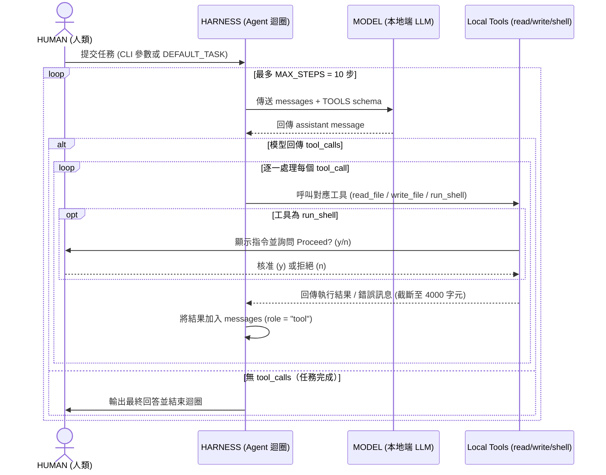

# 02 - 工具呼叫與最小 Agent 迴圈（Tool Use）

本章節使用原生 `openai` SDK 手刻一個最小可用的多步驟 Tool-Use Agent 迴圈，讓本地端模型能自主決定呼叫本地端檔案與終端機工具（`read_file`、`write_file`、`run_shell`），並根據工具回傳結果持續推理直到完成任務。

## 學習目標

- [x] 定義本地端工具函式（`read_file`、`write_file`、`run_shell`）與 OpenAI Function Calling Schema
- [x] 使用 `openai` SDK 實作最小多步驟 Tool-Use Agent 迴圈（含步數上限與錯誤回饋）
- [x] 在執行 `run_shell` 工具前加入人工確認（Human-in-the-loop）、逾時保護與輸出截斷

## 使用環境與套件

- 套件：`openai`、`python-dotenv`
- 共用模組：[utils/llm.py](../utils/llm.py)（`get_openai_client`）、[utils/logger.py](../utils/logger.py)（`get_logger`）
- 本地端模型：見根目錄 `.env`（`LLM_MODEL`）

## 執行方式

使用預設任務執行：

```powershell
uv run python 02_tool_use/main.py
```

或是透過命令列傳入自訂任務：

```powershell
uv run python 02_tool_use/main.py "List files in the workspace and summarize the project."
```

### 附錄：`hello_world.py`（環境檢查）

`02_tool_use/hello_world.py` 是一個與 Agent 無關的小範例，只印出三行問候語，用來確認 `uv` 環境與 Python 執行流程正常：

```powershell
uv run python 02_tool_use/hello_world.py
```

預期輸出：

```text
Hello, World!
Hello, uv!
Hello, corn_agent!
```

## 系統角色與執行流程圖

在 Agent 系統中，**模型（Model）本身不會直接操作檔案或執行指令**，真正負責協調迴圈與執行工具的是外層的 **Harness**，而高風險操作則由 **Human** 把關。

| 角色（Logger 名稱） | 負責工作 |
| :--- | :--- |
| **`HUMAN`**（人類） | 提出初始任務；在執行 `run_shell` 前輸入 `y/n` 進行人工確認（Human-in-the-loop）。 |
| **`HARNESS`**（Agent 外層迴圈） | 維護 `messages` 對話紀錄、控制 `MAX_STEPS` 上限、送出 API 請求、解析並實際執行本地端工具、攔截錯誤與截斷輸出，將結果以 `role: "tool"` 回傳給模型。 |
| **`MODEL`**（本地端 LLM） | 根據目前上下文決定要呼叫哪個工具與參數（`tool_calls`），或在資訊足夠時產出最終回答。 |

### 時序圖（誰在什麼時候做什麼）



### 日誌閱讀方式

程式內建三個獨立 Logger（`HUMAN`、`HARNESS`、`MODEL`），執行時可在終端直接分辨每一步是由誰觸發：

```text
2026-11-21 19:21:00 | INFO     | HARNESS | Starting agent loop (model=..., max_steps=10, tools=['read_file', 'write_file', 'run_shell'])
2026-11-21 19:21:00 | INFO     | HUMAN   | Submitted task: List the files in the current directory...
2026-11-21 19:21:00 | INFO     | HARNESS | [Step 1/10] Sending 2 message(s) to model
2026-11-21 19:21:02 | INFO     | MODEL   | [Step 1] Requested 1 tool call(s)
2026-11-21 19:21:02 | INFO     | MODEL   | [Step 1] Tool call -> run_shell({"command": "dir"})
2026-11-21 19:21:02 | INFO     | HARNESS | [Step 1] Executing local tool: run_shell
2026-11-21 19:21:02 | INFO     | HARNESS | Requesting human confirmation for shell command: dir
2026-11-21 19:21:05 | INFO     | HUMAN   | Approved shell command: dir
2026-11-21 19:21:05 | INFO     | HARNESS | [Step 1] Appending tool 'run_shell' output (412 chars) to messages: ...
2026-11-21 19:21:05 | INFO     | HARNESS | [Step 2/10] Sending 4 message(s) to model
2026-11-21 19:21:08 | INFO     | MODEL   | [Step 2] No tool calls -> returning final answer
2026-11-21 19:21:08 | INFO     | HARNESS | Agent finished in 2 step(s)
```

## 核心概念與實作筆記

1. **工具定義與 Schema 封裝**：
   - 提供 `read_file`、`write_file`、`run_shell` 三個基礎工具，並以 `_tool()` 輔助函式產生符合 OpenAI Function Calling 格式的 `TOOLS` 清單。
2. **最小 Agent 迴圈**：
   - 每次迭代呼叫 `client.chat.completions.create(..., tools=TOOLS)`，將模型回應加入 `messages`。
   - 若模型未回傳 `tool_calls`，代表任務完成並輸出最終結果；若有 `tool_calls`，則依序執行對應工具，並以 `{"role": "tool", "tool_call_id": ..., "content": ...}` 將結果回饋給模型。
   - 設定 `MAX_STEPS = 10` 防止無窮迴圈。
3. **安全與容錯設計**：
   - `run_shell` 執行前需由使用者輸入 `y` 確認，並設定 60 秒逾時與輸出截斷（僅保留最後 4000 字元避免撐爆上下文）。
   - 工具執行發生例外時不會直接中斷程式，而是將錯誤訊息回傳給模型，讓模型有機會自行修正。

## 觀察與心得

- 已完成實作與本地端執行驗證（包含工具呼叫與檔案操作測試）。
