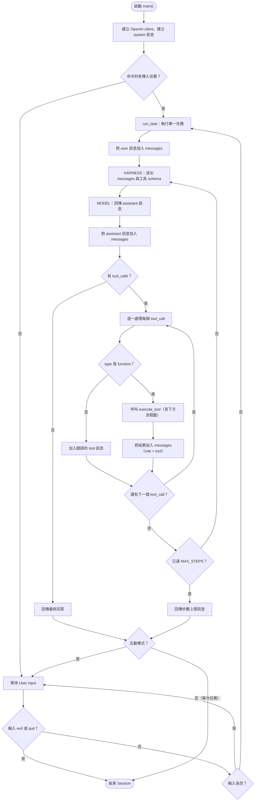
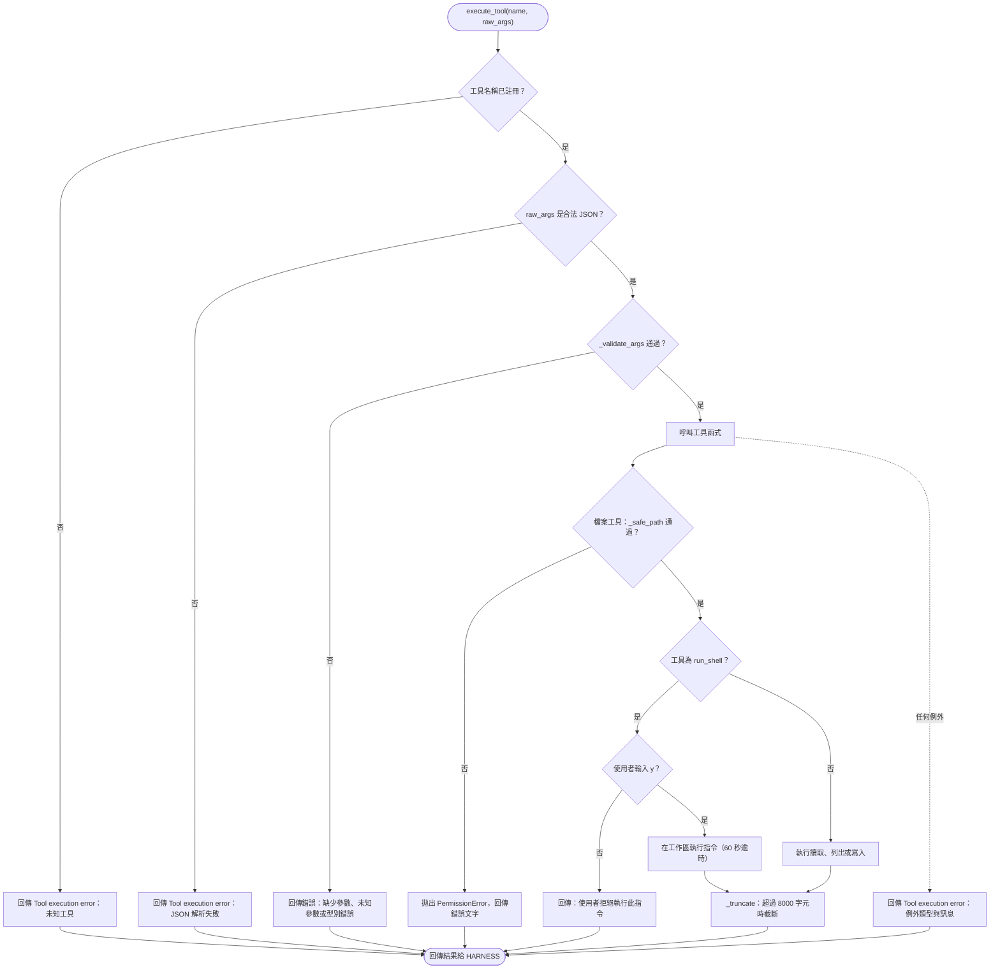
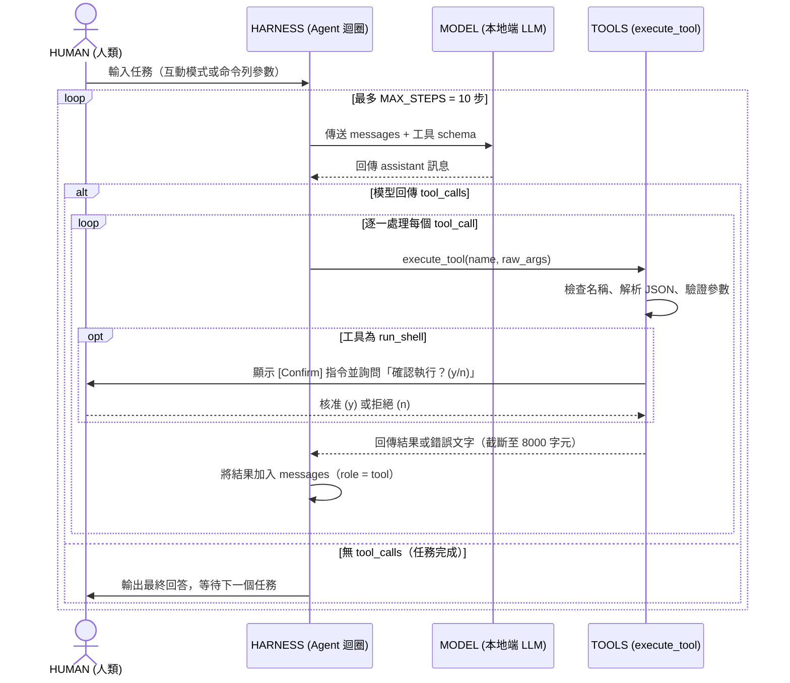

# 03 - 進階工具呼叫（Tool Use Advance）

本章節延續 `02_tool_use` 的最小 Agent 迴圈，加入工具參數驗證、工作區路徑邊界、輸出截斷與多回合對話。模型仍透過原生 `openai` SDK 呼叫，但工具的註冊與執行邏輯集中在 `tools.py`。

## 學習目標

- [x] 強化工具定義與參數驗證（以工具的 JSON Schema 檢查必要參數、未知參數與字串型別）
- [x] 加入工具安全邊界與權限控制（檔案路徑限制在工作區內、禁止存取 `.git` / `.env` / `.venv`、`run_shell` 需使用者確認）
- [ ] 處理多步驟 / 平行工具呼叫與進階錯誤恢復策略（多步驟與錯誤回報已完成；平行工具呼叫尚未實作）
- [x] 改善執行過程的可觀測性（`HUMAN`、`HARNESS`、`MODEL`、`TOOLS` 四組日誌與 token 用量）

## 使用環境與套件

- 套件：`openai`、`python-dotenv`
- 共用模組：[utils/llm.py](../utils/llm.py)（`get_openai_client`）、[utils/logger.py](../utils/logger.py)（`get_logger`）
- 工具模組：`03_tool_use_advance/tools.py`（工具註冊、參數驗證、路徑檢查、輸出截斷）
- 本地端模型：見根目錄 `.env`（`LLM_MODEL`）

## 執行方式

進入互動模式，可以連續輸入多個任務，模型會保留前面的對話內容。輸入 `exit` 或 `quit` 結束：

```powershell
uv run python 03_tool_use_advance/main.py
```

或是只傳入一個任務，執行完後直接結束：

```powershell
uv run python 03_tool_use_advance/main.py "List the files in the workspace folder and summarize them."
```

## 工具清單

| 工具名稱 | 說明 | 參數 | 安全限制 |
| :--- | :--- | :--- | :--- |
| `list_dir` | 列出目錄內的檔案與子目錄 | `path` | 只能存取工作區內的目錄，隱藏 `.git` / `.env` / `.venv` |
| `read_file` | 讀取文字檔內容 | `path` | 同上，且必須是既有檔案 |
| `write_file` | 寫入文字檔（覆寫既有內容） | `path`、`content` | 同上 |
| `run_shell` | 在工作區目錄執行 shell 指令 | `command` | 執行前需輸入 `y` 確認，60 秒逾時 |

工作區是 `tools.py` 所在的資料夾（`03_tool_use_advance/`）。所有路徑都以此資料夾為基準解析。

## 系統角色與執行流程圖

模型本身不會直接讀寫檔案或執行指令。外層的 **Harness** 負責維護對話紀錄、送出請求、執行工具並回傳結果。高風險的 shell 指令則由 **Human** 確認。

| 角色（Logger 名稱） | 負責工作 |
| :--- | :--- |
| **`HUMAN`**（人類） | 輸入任務，或以命令列傳入任務；在 `run_shell` 執行前輸入 `y` / `n` 確認。 |
| **`HARNESS`**（Agent 外層迴圈） | 維護 `messages`、控制 `MAX_STEPS = 10` 上限、送出 API 請求、依序執行 `tool_calls`，並把結果以 `role: "tool"` 回傳給模型。 |
| **`MODEL`**（本地端 LLM） | 決定要呼叫哪個工具與參數（`tool_calls`），或在資訊足夠時產出最終回答。 |
| **`TOOLS`**（工具層） | 檢查工具名稱與參數、執行路徑檢查、執行工具、截斷過長輸出，並記錄失敗原因。 |

### 主流程圖（對話與 Agent 迴圈）



### `execute_tool` 執行流程圖



### 時序圖（誰在什麼時候做什麼）



### 日誌閱讀方式

程式內建四組 Logger。下方是實際執行 `"List the files in the workspace folder, then read the first 5 lines of main.py..."` 的日誌節錄（時間戳與長行已省略）：

```text
HARNESS | Agent ready (model=gemini-4-hydrogen, max_steps=10, tools=['list_dir', 'read_file', 'write_file', 'run_shell'])
HUMAN   | Submitted task: List the files in the workspace folder, then read the first 5 lines of main.py...
HARNESS | [Step 1/10] Sending 2 message(s) to model
MODEL   | [Step 1] finish_reason=tool_calls
MODEL   | [Step 1] Tokens: prompt=383, completion=22
MODEL   | [Step 1] Requested 1 tool call(s)
MODEL   | [Step 1] Tool call -> list_dir({"path":"."})
HARNESS | [Step 1] Executing local tool: list_dir
TOOLS   | 工具 list_dir 執行完成（29 字元）
HARNESS | [Step 1] Appending tool 'list_dir' output (29 chars) to messages: __pycache__/ main.py tools.py
HARNESS | [Step 2/10] Sending 4 message(s) to model
MODEL   | [Step 2] Tool call -> read_file({"path":"main.py"})
HARNESS | [Step 2] Executing local tool: read_file
TOOLS   | 工具 read_file 執行完成（4974 字元）
HARNESS | [Step 3/10] Sending 6 message(s) to model
MODEL   | [Step 3] finish_reason=stop
MODEL   | [Step 3] No tool calls -> returning final answer
HARNESS | Task finished in 3 step(s)
```

`TOOLS` 這組日誌目前仍是 `tools.py` 中的中文訊息。`main.py` 的訊息已改為英文。

## 核心概念與實作筆記

1. **工具註冊與 Schema 封裝**：
   - `tools.py` 用 `@tool(...)` 裝飾器把工具登記在 `TOOLS` 字典中，`get_schemas()` 會把所有工具轉成 OpenAI Function Calling 格式。
   - 新增工具只需要寫一個函式並加上裝飾器，`main.py` 不必修改。
2. **多回合 Agent 迴圈**：
   - `messages` 在互動模式中跨任務保留，因此後續任務可以參考前面的內容。
   - 若模型沒有回傳 `tool_calls`，代表任務完成；若有，則逐一執行並以 `role: "tool"` 回傳結果，每個 `tool_call_id` 都必須有對應的 tool 訊息，否則 API 會拒絕下一次請求。
   - `MAX_STEPS = 10` 防止無窮迴圈。達到上限時，回傳提示訊息並等待下一個任務。
3. **安全邊界**：
   - `_safe_path` 把路徑解析為絕對路徑，確認它位於工作區內，並拒絕 `.git`、`.env`、`.venv`。
   - `run_shell` 在工作區目錄執行，執行前需使用者輸入 `y`，並有 60 秒逾時保護。
4. **錯誤回報與輸出控管**：
   - 工具發生錯誤時，錯誤文字會回傳給模型，讓模型自行修正。
   - 工具輸出超過 8000 字元時會截斷，並標示省略的字元數，避免撐爆上下文。
   - 目前沒有裁剪舊的對話紀錄，長對話仍會累積上下文。

## 觀察與心得

- 已用本地端模型完成一次端到端測試：模型依序呼叫 `list_dir` 與 `read_file`，共 3 步完成，最終回答正確列出檔案並說明 `main.py` 的用途。
- 以 PowerShell 管線傳入 `exit` 時，輸入會帶有 BOM（``），導致無法辨識為結束指令。直接在終端機輸入 `exit` 不會發生這個問題。
- 尚未實作：平行工具呼叫、對話紀錄裁剪，以及把 `tools.py` 的中文日誌與錯誤訊息改為英文。

## 執行紀錄與 HTML 頁面

本課的主迴圈也會寫執行紀錄，並產生可在瀏覽器打開的 HTML 頁面。執行中頁面每 2 秒更新，結束後可以回放。紀錄放在專案根目錄的 `traces/<課名>/`。說明見 [04 的執行紀錄章節](./04_permission.md#執行紀錄與視覺化)。

