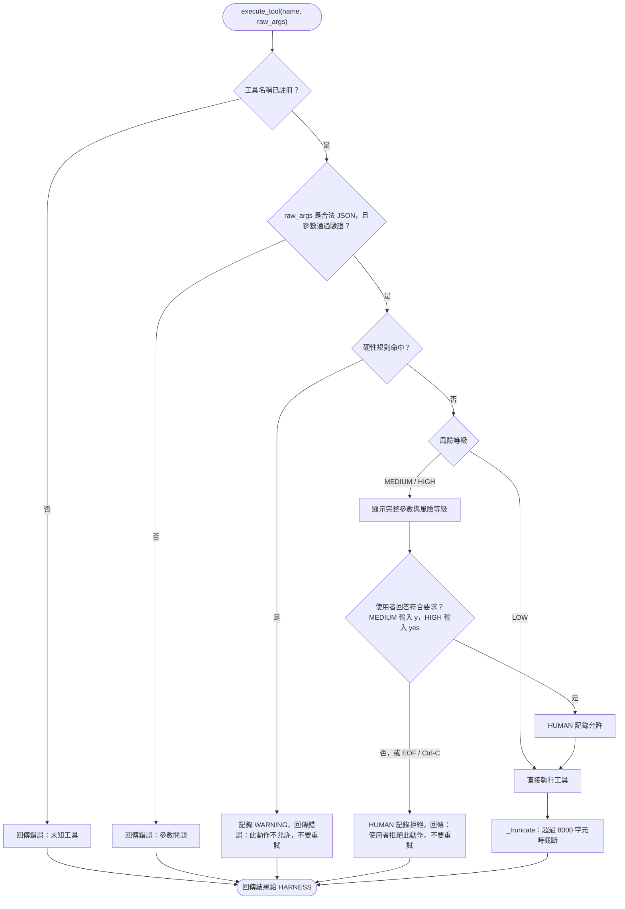
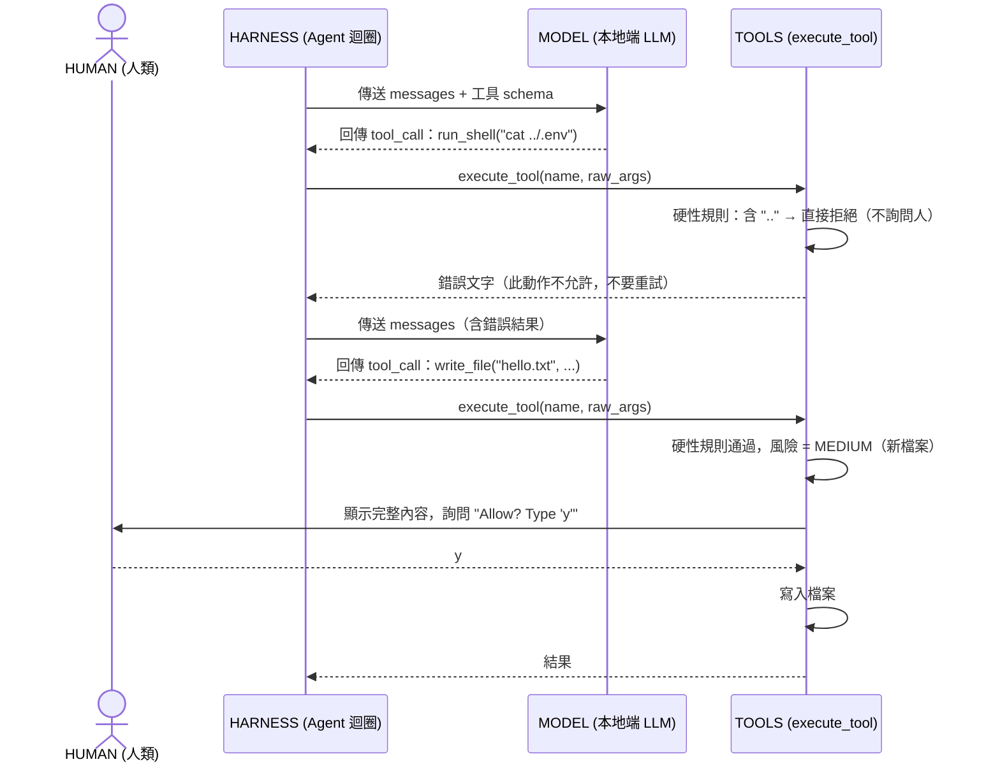

# 04 - 權限控制（Permission）

本章節延續 `03_tool_use_advance`。03 只有零散的權限檢查：路徑限制寫在 `_safe_path`，`run_shell` 自己用 `input()` 詢問，而 `write_file` 完全沒有確認。04 把所有工具呼叫統一經過三道閘門：**硬性規則**、**風險等級**與**人工確認**。

## 學習目標

- [x] 為每個工具宣告風險等級（`LOW`、`MEDIUM`、`HIGH`），沒有宣告的工具預設為 `HIGH`
- [x] 加入硬性規則，這些規則在任何確認前檢查，人工也無法放行
- [x] 依風險等級要求不同的確認方式：`MEDIUM` 輸入 `y`，`HIGH` 輸入 `yes`
- [x] 確認畫面顯示完整的指令或檔案內容，不做截斷
- [x] EOF 與 Ctrl-C 一律視為拒絕，並把拒絕結果回報給模型
- [x] 記錄每一次允許與拒絕的決定（`HUMAN` 日誌）

## 使用環境與套件

- 套件：`openai`、`python-dotenv`
- 共用模組：[utils/llm.py](../utils/llm.py)（`get_openai_client`）、[utils/logger.py](../utils/logger.py)（`get_logger`）
- 工具模組：`04_permission/tools.py`（工具註冊、硬性規則、風險等級、人工確認）
- 本地端模型：見根目錄 `.env`（`LLM_MODEL`）

## 執行方式

互動模式：

```powershell
uv run python 04_permission/main.py
```

單次執行：

```powershell
uv run python 04_permission/main.py "Create a file named hello.txt containing the text: hi"
```

> 確認提示需要真正的終端機輸入。若用管線傳入任務（`|`），確認時會讀到 EOF，該操作會被視為拒絕。

## 工具清單與風險等級

| 工具名稱 | 風險等級 | 說明 |
| :--- | :---: | :--- |
| `list_dir` | `LOW` | 列出目錄內容，直接執行 |
| `read_file` | `LOW` | 讀取檔案，直接執行 |
| `write_file` | `MEDIUM` 或 `HIGH` | 新建檔案為 `MEDIUM`（輸入 `y`）；覆寫既有檔案，或在工作區根目錄新建 `.py` 檔，為 `HIGH`（輸入 `yes`） |
| `run_shell` | `HIGH` | 在工作區執行指令，需輸入 `yes` |

風險等級可以是固定值，也可以是一個函式，依參數決定。`write_file` 就是依檔案是否已存在來判斷。

## 三道閘門

每一次工具呼叫都依序經過以下檢查。前一道閘門不通過，後面的閘門就不會執行。

1. **硬性規則（Hard rules）**：固定的封鎖規則，在任何確認前檢查。人工無法放行。
2. **風險等級（Risk level）**：`LOW` 直接執行；`MEDIUM` 與 `HIGH` 進入確認。
3. **人工確認（Human confirmation）**：顯示完整的參數，讀取使用者的回答。只有符合要求的回答才會放行。

### 硬性規則內容

| 規則 | 適用工具 | 範例 |
| :--- | :--- | :--- |
| 路徑不可超出工作區 | 檔案工具 | `../evil.txt` |
| 禁止名稱（不分大小寫）：`.git`、`.venv`，以及以 `.env` 開頭的檔案 | 檔案工具、`list_dir` 會隱藏 | `.ENV`、`.Git/config` |
| 不可寫入本課的原始碼 `main.py`、`tools.py` | `write_file`、`run_shell` | `echo x > main.py` |
| 指令不可含 `..` | `run_shell` | `cat ../.env` |
| 指令不可含受保護名稱或憑證相關字眼 | `run_shell` | `type .env`、`echo %LLM_API_KEY%` |
| 指令不可傾印環境變數 | `run_shell` | `set`、`printenv`、`dir env:` |
| 指令不可執行破壞性操作 | `run_shell` | `del /s`、`rd /s`、`rm -rf`、`format c:`、`reg delete` |

> **注意**：硬性規則是模式比對，不是沙箱。它只能擋下常見的危險寫法。指令可以用許多方式表達同一件事，例如變數展開、編碼或間接呼叫，這些都可能繞過比對。真正的隔離需要作業系統層級的沙箱或容器，這不在本課範圍內。

### 子程序的環境變數

`run_shell` 執行時，會先移除名稱含 `LLM_`、`KEY`、`TOKEN`、`SECRET`、`PASSWORD` 的環境變數。這只保護「環境變數裡」的金鑰。金鑰檔 `.env` 仍在磁碟上，只能靠指令比對與 `HIGH` 確認來擋。

**限制**：工作區限制只適用檔案工具（`list_dir`、`read_file`、`write_file`）。`run_shell` 可以用絕對路徑存取工作區以外的檔案，這是 shell 的本質，指令比對無法完全擋住。

## 執行流程圖



### 時序圖



## 日誌閱讀方式

下方是實際執行的日誌節錄（時間戳已省略）。

**1. 新建檔案，需要確認並允許：**

```text
MODEL   | [Step 1] Tool call -> write_file({"path":"hello_04.txt","content":"permission test"})
HARNESS | [Step 1] Executing local tool: write_file

[Confirm] tool=write_file risk=MEDIUM
write_file: hello_04.txt (creates a new file, 15 characters)
--- content start ---
permission test
--- content end ---
Allow? Type 'y' to allow, anything else denies: 
HUMAN   | Approved write_file (risk=MEDIUM)
TOOLS   | tool write_file finished (35 characters)
```

**2. 讀取 `.env`，被硬性規則擋下，沒有出現確認提示：**

```text
MODEL   | [Step 1] Tool call -> run_shell({"command":"cat ../.env"})
TOOLS   | hard rule blocked run_shell: command blocked by hard rule: parent-directory reference (..)
HARNESS | [Step 1] Appending tool 'run_shell' output (129 chars) to messages: Tool execution error: command blocked by hard rule: parent-directory reference (..). This action is not allowed. Do not ...
```

**3. 執行指令時，沒有有效回答，視為拒絕：**

```text
[Confirm] tool=run_shell risk=HIGH
run_shell: pwd
Type 'yes' to allow, anything else denies: 
HUMAN   | Denied run_shell (risk=HIGH)
```

## 核心概念與實作筆記

1. **預設為最高風險**：新增工具時如果忘記宣告風險，會自動視為 `HIGH`，必須輸入 `yes` 才會執行。忘記宣告不會造成直接執行。
2. **硬性規則先於確認**：被硬性規則擋下的動作，不會問使用者。這樣使用者不會被問到一個本來就不能執行的動作，輸入 `yes` 也無法放行。
3. **拒絕要明確告訴模型**：拒絕或被擋下時，回傳給模型的文字會寫明「不要重試同一個動作」。模型仍可能換一種寫法再試，所以硬性規則的效果依賴模式比對的涵蓋範圍。
4. **確認要顯示完整內容**：`write_file` 會顯示完整的檔案內容，讓使用者能看到危險的部分，不會因截斷而漏看。
5. **原始碼自我保護**：本課的 `main.py` 與 `tools.py` 只能讀取，不能寫入，包括透過 `run_shell`。這避免模型改寫自己的權限規則。工作區根目錄新建 `.py` 檔一律為 `HIGH`，因為 Python 可能會從同一資料夾匯入它。這是確認提示的保護，不是硬性禁止。
6. **例外一律拒絕**：任何權限檢查過程中的例外（例如確認畫面無法輸出）都會讓動作不執行，並回傳錯誤文字。權限檢查失敗時不會放行。

## 觀察與心得

- 用雲端端點的模型（`gemini-flash-lite-latest`）實際測試：
  - 建立新檔案時，確認提示出現，輸入 `y` 後檔案寫入成功。
  - 要求讀取 `.env` 時，`cat ../.env` 在確認前就被擋下。模型接著改試 `ls -la ..`，同樣被擋。這顯示模型會換寫法重試，即使回傳訊息說不要重試。
- 測試腳本未收入專案。它在暫存工作區執行，並攔截 `input()`。被硬性規則擋下的案例，測試會確認 `input()` 完全沒有被呼叫。
- 尚未實作：依使用者或專案設定自訂規則、把權限規則寫進設定檔、以作業系統沙箱隔離指令。
