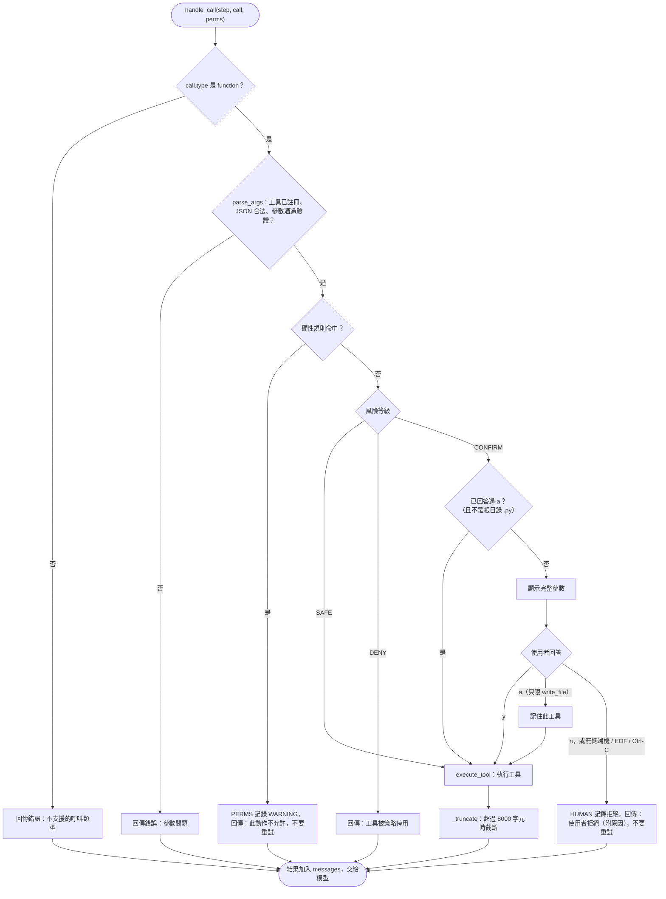
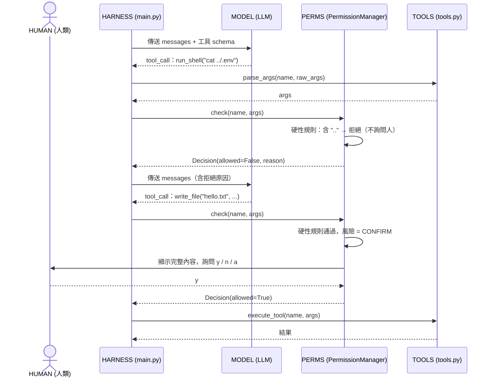

# 04 - 權限控制（Permission）

本章節延續 `03_tool_use_advance`。03 只有零散的權限檢查：路徑限制寫在 `_safe_path`，`run_shell` 自己用 `input()` 詢問，而 `write_file` 完全沒有確認。04 把所有工具呼叫統一經過三道閘門：**硬性規則**、**風險等級**與**人工確認**。

04 也把權限邏輯和工具本身分開。工具寫在 `tools.py`，權限寫在 `permissions.py`。`main.py` 先問 `PermissionManager` 能不能執行，得到允許後才呼叫工具。

## 學習目標

- [x] 把權限檢查集中到獨立的 `PermissionManager`，工具模組不需要知道權限規則
- [x] 為每個工具宣告風險等級（`SAFE`、`CONFIRM`、`DENY`），沒有宣告的工具預設為 `CONFIRM`
- [x] 加入硬性規則，這些規則在任何確認前檢查，人工也無法放行
- [x] 人工確認提供三種回答：`y` 允許一次、`n` 拒絕（可附原因）、`a` 本次執行期間一直允許（只限 `write_file`）
- [x] 確認畫面顯示完整的指令或檔案內容，不做截斷
- [x] 沒有終端機、EOF 與 Ctrl-C 一律視為拒絕，並把拒絕結果與原因回報給模型
- [x] 記錄每一次允許與拒絕的決定（`HUMAN` 與 `PERMS` 日誌）
- [x] 詢問方式可以替換（注入 `ask` 函式），方便測試

## 使用環境與套件

- 套件：`openai`、`python-dotenv`
- 共用模組：[utils/llm.py](../utils/llm.py)（`get_openai_client`）、[utils/logger.py](../utils/logger.py)（`get_logger`）
- 權限模組：`04_permission/permissions.py`（硬性規則、風險等級、人工確認、`PermissionManager`）
- 工具模組：`04_permission/tools.py`（工具註冊、參數驗證、路徑限制、工具執行）
- 本地端模型：見根目錄 `.env`（`LLM_MODEL`）

## 執行方式

互動模式：

```powershell
uv run python 04_permission/main.py
```

單次執行：

```powershell
uv run python 04_permission/main.py "Create a file named hello.txt containing the text: hi"
```

> 確認提示需要真正的終端機。若用管線（`|`）傳入任務，程式偵測不到終端機，所有需要確認的操作都會被拒絕。

## 檔案分工

| 檔案 | 負責的事 | 不做的事 |
| :--- | :--- | :--- |
| `main.py` | Agent 迴圈。`handle_call` 依序做：檢查呼叫類型 → 解析並驗證參數 → 權限檢查 → 執行工具 | 不自己判斷權限 |
| `permissions.py` | 三道閘門與 `PermissionManager.check()`，回傳 `Decision(allowed, reason)` | 不執行工具 |
| `tools.py` | 工具定義、`parse_args`（參數驗證）、`execute_tool`、路徑限制 `safe_path`、輸出截斷 | 不匯入 `permissions.py` |

匯入方向只有一個：`main → permissions → tools`。工具內的 `safe_path` 仍會再檢查一次路徑，作為第二層防護。

## 工具清單與風險等級

| 工具名稱 | 風險等級 | 說明 |
| :--- | :---: | :--- |
| `list_dir` | `SAFE` | 列出目錄內容，直接執行 |
| `read_file` | `SAFE` | 讀取檔案，直接執行 |
| `write_file` | `CONFIRM` | 需要確認。可以回答 `a`，之後本次執行期間不再詢問 |
| `run_shell` | `CONFIRM` | 需要確認。每次都要回答 `y`，沒有 `a` 選項 |

風險等級寫在 `permissions.py` 的 `TOOL_RISK` 表。新增工具時如果忘記加入這張表，會被視為 `CONFIRM`，不會直接執行。`DENY` 用來整個停用某個工具。

**例外**：在工作區根目錄寫入 `.py` 檔，即使已回答過 `a`，仍然每次都會詢問，而且不提供 `a`。因為 Python 會從同一資料夾匯入模組，這種檔案可能取代 `main.py` 匯入的模組。

## 三道閘門

每一次工具呼叫都依序經過以下檢查。前一道閘門不通過，後面的閘門就不會執行。

1. **硬性規則（Hard rules）**：固定的封鎖規則，在任何確認前檢查。人工無法放行。
2. **風險等級（Risk level）**：`SAFE` 直接執行；`DENY` 直接拒絕；`CONFIRM` 進入確認，除非使用者先前已對這個工具回答 `a`。
3. **人工確認（Human confirmation）**：顯示完整的參數，讀取使用者的回答。只有 `y` 或 `a` 會放行。

整個檢查包在 `try/except` 裡。檢查過程中發生任何例外，例如確認畫面無法輸出，動作都不會執行。

### 確認畫面

```text
[Confirm] The agent wants to run: write_file
  path: hello.txt (creates a new file, 2 characters)
--- content start ---
hi
--- content end ---
[y] allow / [n] deny / [a] always allow this session >
```

回答 `n` 後，程式會再問一次拒絕原因（可留空）。原因會一起傳給模型，讓模型知道為什麼被拒絕。

### 硬性規則內容

| 規則 | 適用工具 | 範例 |
| :--- | :--- | :--- |
| 路徑不可超出工作區 | 檔案工具 | `../evil.txt` |
| 禁止名稱（不分大小寫）：`.git`、`.venv`，以及以 `.env` 開頭的檔案 | 檔案工具、`list_dir` 會隱藏 | `.ENV`、`.Git/config` |
| 不可寫入本課的原始碼 `main.py`、`tools.py`、`permissions.py`。檔名尾端的 `.` 與空白會先去掉再比對，因為 Windows 會把 `main.py.` 存成 `main.py` | `write_file`、`run_shell` | `echo x > permissions.py`、`write_file("main.py.")` |
| 寫入類指令（`>`、`copy`、`del`、`python`、`py`、`open` 等）不可提到受保護原始碼，也不可用萬用字元（`*`、`?`、`[...]`）配到它們。不會配到原始碼的萬用字元不受影響，例如 `print(2*3)`、`copy *.txt backup` | `run_shell` | `python -c "open('main.py','w')"`、`echo x > mai[n].py`、`del *.py` |
| 指令不可含 `..` | `run_shell` | `cat ../.env` |
| 指令不可含受保護名稱或憑證相關字眼 | `run_shell` | `type .env`、`echo %LLM_API_KEY%` |
| 指令不可傾印環境變數 | `run_shell` | `set`、`printenv`、`dir env:` |
| 指令不可執行破壞性操作 | `run_shell` | `del /s`、`rd /s`、`rm -rf`、`format c:`、`reg delete`、`sudo`、`curl ... \| sh` |

> **注意**：硬性規則是模式比對，不是沙箱。它只能擋下常見的危險寫法。指令可以用許多方式表達同一件事，例如變數展開、編碼或間接呼叫，這些都可能繞過比對。例如 `python -c "open('perm'+'issions.py','w')"` 把檔名拆開來寫，目前的規則擋不住。真正的隔離需要作業系統層級的沙箱或容器，這不在本課範圍內。

### 子程序的環境變數

`run_shell` 執行時，會先移除名稱含 `LLM_`、`KEY`、`TOKEN`、`SECRET`、`PASSWORD` 的環境變數。這只保護「環境變數裡」的金鑰。金鑰檔 `.env` 仍在磁碟上，只能靠指令比對與人工確認來擋。

**限制**：工作區限制只適用檔案工具（`list_dir`、`read_file`、`write_file`）。`run_shell` 可以用絕對路徑存取工作區以外的檔案，這是 shell 的本質，指令比對無法完全擋住。

## 執行流程圖



### 時序圖



## 日誌閱讀方式

下方日誌來自本地測試腳本（時間戳已省略）。測試腳本用假的 tool call 取代模型，並注入自動回答的 `ask` 函式，所以沒有 `[Confirm]` 畫面。實際接上模型時，`MODEL` 那一行來自模型的真實回應。

**1. 讀取 `.env`，被硬性規則擋下，沒有詢問使用者：**

```text
INFO     | MODEL | [Step 1] Tool call -> run_shell({"command":"cat ../.env"})
WARNING  | PERMS | denied run_shell: command blocked by hard rule: parent-directory reference (..). This action is not allowed. Do not retry it.
```

**2. 想改寫權限規則本身，被硬性規則擋下：**

```text
INFO     | MODEL | [Step 1] Tool call -> write_file({"path":"permissions.py","content":"x"})
WARNING  | PERMS | denied write_file: writing permissions.py is not allowed (protected source file). This action is not allowed. Do not retry it.
```

**3. 回答 `a` 後，下一次 `write_file` 自動放行：**

```text
INFO     | MODEL | [Step 1] Tool call -> write_file({"path":"y.txt","content":"2"})
INFO     | HUMAN | Auto-approved write_file (always allowed this session)
INFO     | HARNESS | [Step 1] Executing local tool: write_file
INFO     | TOOLS | tool write_file finished (14 characters)
```

**4. 使用者拒絕：**

```text
INFO     | MODEL | [Step 1] Tool call -> run_shell({"command":"dir"})
WARNING  | HUMAN | Denied run_shell
WARNING  | PERMS | denied run_shell: The user denied this action. Do not retry the same action. Try a different approach, or tell the user what you want to do and why.
```

## 核心概念與實作筆記

1. **權限與工具分離**：`tools.py` 只負責「怎麼做」，`permissions.py` 負責「能不能做」。之後要換成聊天介面確認或無人值守的預先授權，只需要替換 `ask` 函式或 `PermissionManager`，工具不用改。
2. **預設需要確認**：新增工具時如果忘記在 `TOOL_RISK` 宣告風險，會自動視為 `CONFIRM`。忘記宣告不會造成直接執行。
3. **硬性規則先於確認**：被硬性規則擋下的動作，不會問使用者。使用者不會被問到一個本來就不能執行的動作，回答 `y` 或 `a` 也無法放行。
4. **`a` 的範圍要小**：`a` 只對 `write_file` 提供，而且只在本次執行期間有效。`run_shell` 每次都要確認，因為指令內容每次都不一樣，風險也不一樣。工作區根目錄的 `.py` 檔不受 `a` 影響。
5. **拒絕要明確告訴模型**：拒絕或被擋下時，回傳給模型的文字會寫明「不要重試同一個動作」，使用者給的拒絕原因也會一起傳回。模型仍可能換一種寫法再試，所以硬性規則的效果依賴模式比對的涵蓋範圍。
6. **確認要顯示完整內容**：`write_file` 會顯示完整的檔案內容。如果截斷，危險的部分可能藏在被截掉的地方。
7. **原始碼自我保護**：本課的 `main.py`、`tools.py`、`permissions.py` 只能讀取，不能寫入，包括透過 `run_shell`。這避免模型改寫自己的權限規則。
8. **例外一律拒絕**：權限檢查過程中的任何例外都會讓動作不執行，並回傳錯誤文字。權限檢查失敗時不會放行。Ctrl-C 產生的 `KeyboardInterrupt` 不屬於 `Exception`，所以程式另外列出它。在確認畫面按 Ctrl-C 只會拒絕這一次操作，不會中斷整個程式。

## 觀察與心得

- 以下觀察是在權限邏輯拆到 `permissions.py` 之前，用雲端端點的模型（`gemini-flash-lite-latest`）實測的。拆分後，原有的硬性規則全部保留，另外新增了幾條，所以下列結果仍適用：
  - 建立新檔案時，確認提示出現，允許後檔案寫入成功。
  - 要求讀取 `.env` 時，`cat ../.env` 在確認前就被擋下。模型接著改試 `ls -la ..`，同樣被擋。這顯示模型會換寫法重試，即使回傳訊息說不要重試。
- 測試腳本未收入專案。它注入自動回答的 `ask` 函式，並把工具換成假的函式來記錄執行次數。測試涵蓋：硬性規則命中時完全沒有詢問、`y` / `n` / `a` 三種回答、`a` 之後硬性規則仍然有效、根目錄 `.py` 檔在 `a` 之後仍會詢問、壞參數、`ask` 丟出例外或 Ctrl-C 時拒絕、每個呼叫只執行一次。也測試了硬性規則的兩個方向：該擋的指令（例如 `del *.py`、`main.py.`）會被擋，不該擋的指令（例如 `type main.py`、`python -c "print(2*3)"`）可以通過。
- 待補：拆分後的版本尚未接上真實模型做互動實測（含 `[a]` 選項）。
- 尚未實作：依使用者或專案設定自訂規則、把權限規則寫進設定檔、以作業系統沙箱隔離指令。
